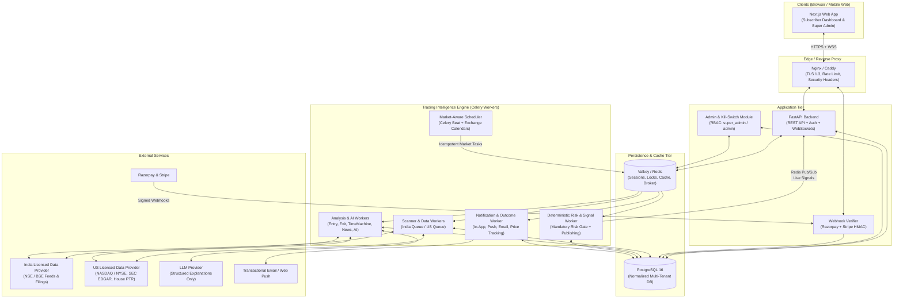
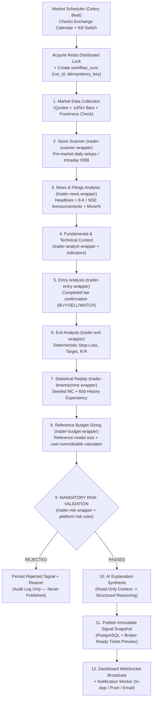
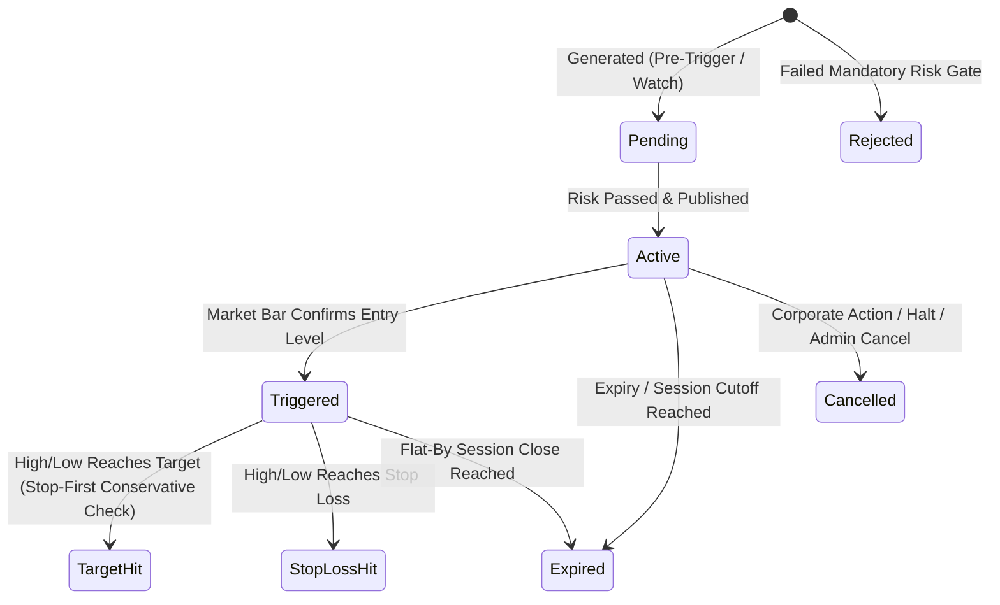
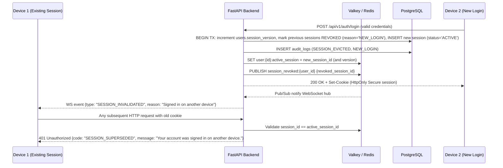

# System Architecture Blueprint — AI Trading Intelligence SaaS Platform

**Project:** `trade-intelligence-platform` (Private Commercial SaaS)  
**Markets:** India (`NSE`, `BSE` — `INR`, `Asia/Kolkata`) & United States (`NASDAQ`, `NYSE` — `USD`, `America/New_York`)  
**Operating Mode:** **STRICT SIGNALS-ONLY MODE** (Zero automated live broker order execution)

---

## 1. Architectural Principles

1. **Signals-Only Hard Boundary:** No code path may submit, modify, or cancel live orders on any brokerage. `trader-broker` is strictly restricted to generating read-only, broker-ready trade tickets for manual user review.
2. **Deterministic Math vs. AI Reasoning Separation:** All financial calculations (entry triggers, ATR/midpoint stops, R-multiple targets, risk/reward, position sizing, exposure, daily risk caps, signal expiry, historical performance) execute in deterministic, unit-tested Python (`Decimal` for monetary math). LLMs are restricted to structured explanation, news synthesis, and interactive Q&A — an LLM can **never** alter a price level or override a `trader-risk` rejection.
3. **Mandatory Non-Overridable Risk Gate:** Every candidate signal must pass `risk-engine` validation before publication. A `REJECTED` signal is stored for auditability and never published to subscribers as an active opportunity.
4. **Shared Intelligence, Isolated User Data:** Market scans, quotes, corporate filings, and published signals are computed **once per market** and shared across eligible subscribers to prevent duplicate scans and API cost spikes. All user-specific state (watchlists, personal risk/budget settings, journals, notifications, sessions, subscriptions, payments) is strictly isolated by `user_id` at the API and database layers.
5. **Single Active Session Enforcement:** Every user has at most **one** active authenticated session at any instant, enforced server-side via PostgreSQL + Redis session versioning and real-time WebSocket invalidation.
6. **Provider & Market Agnostic Core:** Exchange rules, calendars, symbol mappings, currencies, and data vendors live behind explicit Python interfaces (`MarketAdapter` and `MarketDataProvider`). Free unofficial feeds are never represented as live commercial data.
7. **Immutable Signal Audit Trail:** Published signal snapshots are append-only/immutable. Subsequent status transitions (`Active` → `Triggered` → `Target Hit` / `Stop Loss Hit` / `Expired`) are recorded in `signal_updates` and `signal_outcomes` — historical signals are never edited retroactively.

---

## 2. High-Level System Architecture



---

## 3. Repository Structure (Modular Monorepo)

```text
trade-intelligence-platform/
├── frontend/                         # Next.js (App Router), TypeScript, Tailwind, shadcn/ui
│   ├── src/
│   │   ├── app/                      # Route groups: (auth), (dashboard), (admin)
│   │   ├── components/               # Reusable UI primitives, tables, badges, modals
│   │   ├── features/
│   │   │   ├── dashboard/            # Overview, market status cards, indices
│   │   │   ├── markets/              # India (NSE/BSE) & US (NASDAQ/NYSE) views
│   │   │   ├── scanner/              # Stock scanner table, filters, freshness banners
│   │   │   ├── signals/              # Signal cards, details, entry/SL/target ladder
│   │   │   ├── charts/               # TradingView Lightweight Charts wrappers
│   │   │   ├── analysis/             # Stock analysis, fundamentals, AI analyst chat
│   │   │   ├── news/                 # Market news & regulatory filings feed
│   │   │   ├── watchlist/            # Personal watchlists & trading journal
│   │   │   ├── performance/          # Historical outcomes & methodology disclosures
│   │   │   ├── notifications/        # In-app inbox & preference controls
│   │   │   ├── subscriptions/        # Plans, Razorpay/Stripe checkout, invoices
│   │   │   └── admin/                # Super Admin panel & emergency kill switch
│   │   ├── lib/                      # Typed API client, WebSocket manager, formatters
│   │   └── types/                    # Shared TypeScript contracts
│   └── package.json
│
├── backend/                          # FastAPI application (Python 3.12+)
│   ├── app/
│   │   ├── main.py                   # FastAPI entrypoint, middleware, lifespan
│   │   ├── core/                     # Config, security, Argon2id, CSRF, rate limits, logging
│   │   ├── api/v1/                   # Versioned REST & WebSocket routers
│   │   ├── authentication/           # Server-side sessions, single-session manager, RBAC
│   │   ├── users/                    # Profiles, preferences, watchlists, trading journal
│   │   ├── subscriptions/            # Plan management, entitlement checks, grace periods
│   │   ├── payments/                 # Razorpay & Stripe adapters, verified webhooks, invoices
│   │   ├── signals/                  # Signal query APIs, outcomes, performance stats
│   │   ├── notifications/            # In-app, Web Push, email delivery & preferences
│   │   └── admin/                    # Super Admin APIs, audit logs, kill switch, metrics
│   └── pyproject.toml
│
├── trading-engine/                   # Isolated Python package (importable by Celery & Backend)
│   ├── skills/                       # Preserved upstream 11 skills (read-only/minimal patches)
│   │   ├── trader-alerts/
│   │   ├── trader-analyst/
│   │   ├── trader-broker/            # Ticket rendering ONLY (order placement disabled)
│   │   ├── trader-budget/
│   │   ├── trader-entry/
│   │   ├── trader-exit/
│   │   ├── trader-news/
│   │   ├── trader-pelosi/
│   │   ├── trader-risk/
│   │   ├── trader-scanner/
│   │   └── trader-timemachine/
│   ├── skill_wrappers/               # Standardized BaseSkill interface around each skill
│   ├── domain/                       # Canonical data models (Instrument, Bar, Quote, Signal)
│   ├── adapters/
│   │   ├── base.py                   # Abstract MarketAdapter & MarketCalendar
│   │   ├── india/                    # NSE/BSE symbols, IST 09:15-15:30, holidays, INR ticks
│   │   └── usa/                      # NASDAQ/NYSE symbols, ET 09:30-16:00, DST, USD ticks
│   ├── data_providers/
│   │   ├── base.py                   # Abstract MarketDataProvider, NewsProvider, FundamentalsProvider
│   │   ├── mock/                     # Deterministic offline fixtures for automated tests
│   │   ├── india_provider/           # Licensed NSE/BSE vendor adapter
│   │   ├── us_provider/              # Licensed US vendor + SEC EDGAR + House PTR adapters
│   │   └── dev_yahoo/                # Local R&D fallback (strictly disabled in production env)
│   ├── signal_engine/                # Signal classification (BUY/SELL/WATCH), calibrated scoring
│   ├── risk_engine/                  # Deterministic platform + user-level risk validation gate
│   ├── ai_analyst/                   # Decoupled LLM synthesis & explanation generator
│   ├── scheduler/                    # Celery Beat market-session triggers
│   └── workflows/                    # Explicit DAG workflow engine, run IDs, idempotency
│
├── database/
│   ├── models/                       # SQLAlchemy 2.x ORM models (shared by backend & engine)
│   ├── migrations/                   # Alembic versioned migrations
│   └── seeds/                        # Markets, exchanges, roles, default subscription plans
│
├── tests/
│   ├── unit/                         # Calculations, calendars, risk rules, skill wrappers
│   ├── integration/                  # DB transactions, workflow DAGs, idempotency, dedupe
│   ├── api/                          # Auth, RBAC, multi-user isolation, session eviction, webhooks
│   ├── security/                     # Injection, CSRF, rate-limit, secret-leak checks
│   ├── frontend/                     # Vitest / Playwright UI tests
│   └── fixtures/                     # Offline mock market bars, quotes, filings, webhooks
│
├── docs/
│   ├── EXISTING_SYSTEM_AUDIT.md
│   ├── ARCHITECTURE.md
│   ├── DEVELOPMENT_ROADMAP.md
│   ├── api/                          # OpenAPI specs & WebSocket event schemas
│   ├── deployment/                   # Docker, VPS/cloud runbooks, backup/restore
│   └── security/                     # Threat model, compliance checklist, incident response
│
├── docker/
│   ├── backend.Dockerfile
│   ├── worker.Dockerfile
│   ├── frontend.Dockerfile
│   └── docker-compose.yml
│
├── .env.example                      # Placeholders only (zero secrets)
├── README.md
├── LICENSE                           # Platform license + preserved MIT notices
├── UPSTREAM.md                       # Upstream repo URL, commit SHA, sync policy
└── THIRD_PARTY_NOTICES               # All third-party & upstream attribution texts
```

> **Justification for minor improvements over proposed layout:** Adding `trading-engine/domain/` (canonical internal models), `trading-engine/skill_wrappers/` (clean typed boundary around the 11 preserved skill folders), `trading-engine/ai_analyst/` (isolating LLM prompts from math), and `database/models/` (shared ORM layer between `backend` and `trading-engine`) prevents circular imports and keeps upstream skill scripts clean and auditable.

---

## 4. Market Adapter & Data Provider Architecture

### 4.1 Common Internal Data Model
Every skill wrapper, scanner, risk rule, and API endpoint speaks a single canonical domain schema (`trading-engine/domain/`):
- `Instrument`: `instrument_id`, `market_code` (`IN` | `US`), `exchange_code` (`NSE` | `BSE` | `NASDAQ` | `NYSE`), `canonical_symbol` (e.g., `NSE:RELIANCE`, `NASDAQ:TSLA`), `display_symbol`, `company_name`, `asset_type` (`EQUITY` | `ETF`), `currency` (`INR` | `USD`), `tick_size` (`Decimal`), `lot_size`, `provider_symbols` (JSON map per provider).
- `OHLCVBar`: `instrument_id`, `timeframe` (`1m` | `5m` | `15m` | `1d`), `bar_start_utc`, `bar_end_utc`, `open`, `high`, `low`, `close` (`Decimal`), `volume` (`int`), `is_complete` (`bool`), `source_provider`, `fetched_at_utc`.
- `QuoteSnapshot`: `instrument_id`, `last_price`, `prev_close`, `bid`, `ask`, `volume`, `quote_timestamp_utc`, `fetched_at_utc`, `source_provider`, `is_delayed` (`bool`), `delay_seconds` (`int`).

### 4.2 Independent Market Adapters

| Dimension | India Market Adapter (`adapters/india/`) | US Market Adapter (`adapters/usa/`) |
| --- | --- | --- |
| Exchanges | `NSE`, `BSE` | `NASDAQ`, `NYSE` |
| Asset Classes | Indian Equities + Indian ETFs | US Equities + US ETFs |
| Currency & Precision | `INR`, tick size `₹0.05` (or exchange band rules) | `USD`, tick size `$0.01` |
| Timezone | `Asia/Kolkata` (UTC+05:30, no DST) | `America/New_York` (UTC-05:00 / UTC-04:00, auto DST via `zoneinfo`) |
| Sessions | Pre-open `09:00–09:15 IST`, Regular `09:15–15:30 IST` (**75** 5m bars), Closing `15:40–16:00 IST` | Pre-market `04:00–09:30 ET`, Regular `09:30–16:00 ET` (**78** 5m bars), Early Close `13:00 ET` |
| Calendars | `exchange-calendars` (`XBOM`/`XNSE`) + DB holiday & Muhurat-session override table | `exchange-calendars` (`XNYS`/`XNAS`) + DB holiday/early-close override table |
| Symbol Rules | Up to 20 chars, permits `&` and `-` (e.g., `M&M`, `BAJAJ-AUTO`, `HDFCBANK`), never mutates dots blindly | Standard US symbols (`AAPL`, `BRK.B`), explicit provider mapper (`BRK.B` → `BRK-B` only for providers requiring it) |
| Filings & Disclosures | NSE/BSE Corporate Announcements & Financial Results provider | SEC EDGAR XBRL (`trader-analyst`), 8-K Atom (`trader-news`), US House Clerk PTR (`trader-pelosi`) |

### 4.3 Data Freshness & Fail-Safe Policy
- Every quote and bar carries `source_provider`, `quote_timestamp_utc`, and `fetched_at_utc`.
- **Staleness Guard:** If quote age exceeds configurable threshold (default `15 minutes` for intraday risk/entry checks, `5 minutes` for live signal triggers), the data is flagged `STALE`, signal generation is halted for affected symbols, and the UI displays an explicit **Delayed / Stale Data Warning** banner.
- **No Fabricated Prices:** If a provider returns an error or timeout, the platform marks `provider_status = DEGRADED/DOWN`, logs the incident, and renders `"Data Unavailable"` — it never falls back to synthetic or cached-as-live prices.
- **Commercial Provider Pluggability:** Switching vendors requires implementing `MarketDataProvider` (`get_universe`, `get_quotes`, `get_bars`, `health_check`) and toggling `MARKET_DATA_PROVIDER_IN` / `MARKET_DATA_PROVIDER_US` via env config — zero changes to the trading engine.

---

## 5. Centralized Workflow Engine & Skill Integration

### 5.1 Automated Market Workflow DAG



### 5.2 Independent Scheduled Workflows
- **Universe Sync (`trader-scanner universe`):** Weekly + on-demand admin refresh per market (`IN`, `US`).
- **Pre-Market Daily Scan:** Runs 45–60 min before each market open (`08:15 IST` for India, `08:30 ET` for US).
- **Intraday ORB & Entry/Signal Pipeline:** Runs on every 5-minute completed bar window during regular sessions (`09:35–15:00 IST` for India; `09:50–15:30 ET` for US).
- **Signal Outcome & Price Alert Monitor (`trader-alerts`):** Runs every 1–5 minutes during active sessions to detect `Triggered`, `Target Hit`, `Stop Loss Hit`, and `Expired` transitions and dispatch user alerts.
- **Fundamentals Refresh (`trader-analyst`):** Nightly / post-earnings filing detection.
- **US Congressional Disclosures (`trader-pelosi`):** Hourly on US weekdays (tagged strictly as US-market delayed public disclosure intelligence with explicit 45-day disclosure lag metadata).
- **End-of-Day Closing Report & Signal Expiry:** Runs at market close (`15:30 IST`, `16:00 ET` or `13:00 ET` early close).

### 5.3 Reliability, Idempotency & Concurrency Guarantees
- **Unique `workflow_run_id` (UUIDv7) & `idempotency_key`:** Computed as `sha256(market_code + workflow_type + session_date + bar_slot_utc)`. A unique DB constraint on `(workflow_type, market_code, idempotency_key)` + Redis lock (`SET NX EX`) guarantees that multiple workers or retries never execute duplicate scans or publish duplicate signals.
- **Per-Skill Execution Logging:** Every stage writes a row to `skill_runs` (`skill_name`, `workflow_run_id`, `status`, `started_at`, `finished_at`, `duration_ms`, `input_summary`, `output_summary`, `error_trace`, `retry_count`).
- **Global Emergency Kill Switch:** Stored in PostgreSQL (`system_settings.kill_switch_enabled`) and mirrored in Redis (`system:kill_switch`). Every workflow entrypoint and signal publisher checks the kill switch before starting and before publishing. Enabling it immediately halts all new automated scans and signal publications while keeping historical data, user dashboards, and admin tools completely intact.

---

## 6. Signal Generation & Historical Performance Methodology

### 6.1 Signal Schema & State Machine
Every signal record is stored as an immutable snapshot in `trading_signals`:
- Core fields: `id`, `workflow_run_id`, `market_id`, `exchange_id`, `instrument_id`, `strategy`, `signal_type` (`BUY` | `SELL` | `WATCH`), `entry_price`, `stop_loss`, `target_price`, `risk_reward_ratio`, `confidence_score` (`0–100`), `confidence_breakdown` (JSON), `ai_reasoning`, `technical_indicators` (JSON), `news_context` (JSON), `timemachine_summary` (JSON), `risk_validation_status` (`PASSED` | `REJECTED`), `risk_validation_details` (JSON), `broker_ticket_preview` (JSON, read-only), `generated_at_utc`, `expires_at_utc`, `current_status`.



### 6.2 Calibrated Confidence Score (No Arbitrary LLM Probabilities)
Confidence (`0–100`) is **explicitly labeled as a Composite Setup Quality Score, NOT a probability of profit**. It is computed deterministically from documented weighted components:
- Technical setup strength & volume confirmation (35%)
- Reward-to-risk & spread-to-risk structure (20%)
- Historical replay / Time Machine expectancy & sample size (25%)
- News / earnings / regulatory catalyst alignment or risk deduction (20%)

### 6.3 Documented Outcome Tracking Methodology
- Tracked automatically via `signal_outcomes` using subsequent completed market bars (`5m` intraday / `1d` swing).
- **Conservative Tie-Breaking:** If a single bar's high/low touches both stop-loss and target, the outcome is recorded as **Stop Loss Hit** (matching `trader-timemachine`'s conservative rule).
- **Slippage & Cost Assumptions:** Outcomes record both `gross_return_pct` and `net_return_pct` (applying documented, transparent per-market slippage and statutory/brokerage cost models: e.g., STT/exchange/GST estimates for India, SEC/slippage basis points for US).
- **Zero Retroactive Edits:** Signals cannot be deleted or modified after publication; corrections/cancellations append new `signal_updates` rows with full audit trails.

---

## 7. Multi-User SaaS, Auth & Single Active Session Architecture

### 7.1 Authentication & Security Controls
- **Password Hashing:** `Argon2id` (`argon2-cffi`, OWASP recommended memory/time/parallelism parameters).
- **Session Transport:** Opaque cryptographically random 256-bit session tokens stored in `HttpOnly`, `Secure`, `SameSite=Lax` cookies (never stored in `localStorage`).
- **CSRF Protection:** Double-submit / synchronizer CSRF token header verified on all state-changing `POST`/`PUT`/`PATCH`/`DELETE` requests.
- **RBAC:** Roles (`super_admin`, `admin`, `subscriber`) enforced via FastAPI dependency guards and database-level ownership filters (`WHERE user_id = :current_user_id`).
- **Rate Limiting:** Redis-backed sliding-window rate limits per IP and per user on auth (`/login`, `/register`, `/password-reset`), AI analyst endpoints, and API reads.

### 7.2 Single Active Session Enforcement



- **Super Admin Session Revocation:** Super Admins can inspect active sessions (`device`, `ip_masked`, `created_at`, `last_seen_at`) and immediately revoke any user's session via the exact same DB + Redis + WebSocket mechanism.

---

## 8. Subscription & Payment Architecture

- **Dual Payment Gateways:**
  - **Razorpay** for Indian customers (`INR`, UPI / cards / netbanking / mandates).
  - **Stripe** for international customers (`USD`, cards / automatic recurring billing).
- **Strict Webhook-Driven Activation:** Frontend checkout redirects **never** activate subscriptions. Activation occurs exclusively when a cryptographically verified webhook (`X-Razorpay-Signature` HMAC-SHA256 or `Stripe-Signature` timestamp + HMAC) is processed idempotently via `payment_events(provider, provider_event_id UNIQUE)`.
- **Lifecycle States:** `trialing` → `active` → `past_due` (configurable grace period, e.g., 3 days) → `expired` | `cancelled`.
- **Entitlement Middleware:** Protected subscriber endpoints verify `subscription.status IN ('active', 'trialing', 'past_due_within_grace')` and market entitlement (`IN`, `US`, or `ALL`).
- **Configurable Plans:** Super Admin can create/edit pricing plans, billing intervals, market access scopes, and grace period durations without code deploys.

---

## 9. Normalized PostgreSQL Database Schema

All timestamps are stored as `TIMESTAMPTZ` (UTC). Monetary values use `NUMERIC(18, 6)` or `NUMERIC(14, 4)` (never floating-point).

| Domain | Tables | Key Constraints & Indexes |
| --- | --- | --- |
| **Identity & Access** | `roles`, `users`, `sessions`, `audit_logs` | `users.email UNIQUE`, `users.session_version INT NOT NULL`, partial unique index `UNIQUE(user_id) WHERE status = 'ACTIVE'` on `sessions` (database-enforced single active session!), `audit_logs(actor_id, created_at DESC)` |
| **Subscriptions & Billing** | `subscription_plans`, `subscriptions`, `payments`, `payment_events` | `payment_events(provider, provider_event_id) UNIQUE`, `subscriptions(user_id, status)`, `payments(subscription_id, created_at DESC)`, invoice numbers `UNIQUE` |
| **Markets & Data** | `markets`, `exchanges`, `instruments`, `market_data`, `provider_status` | `instruments(exchange_id, symbol) UNIQUE`, `market_data(instrument_id, timeframe, bar_start_utc) UNIQUE`, composite time-series index `(instrument_id, timeframe, bar_start_utc DESC)` |
| **Workflows & Skills** | `workflow_runs`, `skill_runs`, `system_settings` | `workflow_runs(workflow_type, market_code, idempotency_key) UNIQUE`, `skill_runs(workflow_run_id, skill_name)` |
| **Signals & Outcomes** | `trading_signals`, `signal_updates`, `signal_outcomes`, `market_news`, `congress_disclosures`, `company_fundamentals` | `trading_signals(market_id, current_status, generated_at_utc DESC)`, `trading_signals(instrument_id, generated_at_utc DESC)`, `signal_updates(signal_id, created_at_utc)`, `signal_outcomes(signal_id) UNIQUE` |
| **User-Isolated Workspace** | `watchlists`, `watchlist_items`, `user_preferences`, `user_trading_journal`, `alerts`, `notification_preferences`, `notifications` | All tables enforce `user_id FK -> users(id) ON DELETE CASCADE` and composite indexes starting with `user_id`; `watchlist_items(watchlist_id, instrument_id) UNIQUE`; `notifications(user_id, is_read, created_at DESC)` |

> **Standout DB Integrity Feature:** Putting a PostgreSQL **partial unique index** `CREATE UNIQUE INDEX uq_sessions_one_active_per_user ON sessions (user_id) WHERE status = 'ACTIVE';` guarantees single-active-session integrity even under concurrent login race conditions.

---

## 10. API & Real-Time Contract Overview

### REST API (`/api/v1/`)
- **Auth & Sessions:** `POST /auth/register`, `POST /auth/login`, `POST /auth/logout`, `POST /auth/password-reset/request`, `POST /auth/password-reset/confirm`, `GET /auth/me`
- **Markets & Instruments:** `GET /markets/status`, `GET /markets/{code}/indices`, `GET /instruments/search`, `GET /instruments/{id}/bars`, `GET /instruments/{id}/fundamentals`
- **Scanner & Signals:** `GET /scanner/results`, `GET /signals`, `GET /signals/{id}`, `GET /signals/{id}/history`, `GET /signals/performance/summary`
- **News & Disclosures:** `GET /news`, `GET /disclosures/congress` (US)
- **AI Analyst:** `POST /ai-analyst/explain/{signal_id}`, `POST /ai-analyst/query` (rate-limited, read-only context)
- **User Workspace (Strictly `user_id` Scoped):** `CRUD /watchlists`, `CRUD /journal`, `GET/PATCH /preferences`, `GET/PATCH /notifications/preferences`, `GET /notifications`, `POST /notifications/{id}/read`, `POST /tools/position-size` (personal calculator using `trader-budget` math)
- **Subscriptions & Webhooks:** `GET /subscriptions/plans`, `GET /subscriptions/me`, `POST /subscriptions/checkout`, `POST /subscriptions/cancel`, `GET /payments/history`, `POST /webhooks/razorpay`, `POST /webhooks/stripe`
- **Super Admin (`/api/v1/admin/`):** `GET /admin/overview`, `GET/PATCH /admin/users`, `POST /admin/users/{id}/revoke-session`, `CRUD /admin/plans`, `GET /admin/workflows`, `GET /admin/skills/runs`, `GET /admin/providers/status`, `POST /admin/kill-switch`, `GET /admin/audit-logs`

### WebSocket Channels (`/ws/v1/stream`)
Authenticated via the same `HttpOnly` session cookie on upgrade:
- `session.invalidated` — instant logout trigger on old device
- `market.status` — market open/close/freshness state changes
- `signal.created` / `signal.updated` — live published signals & status transitions
- `notification.created` — real-time user alerts (entry/target/SL/expiry/news)

---

## 11. Frontend Architecture (FinTech Dashboard)

- **Framework:** Next.js (App Router) + TypeScript + Tailwind CSS + shadcn/ui + TradingView Lightweight Charts.
- **Visual Design System:**
  - Default **Dark FinTech Theme** (deep obsidian/slate surfaces, crisp emerald/crimson/amber semantic tokens for `BUY` / `SELL` / `WATCH`, tabular monospace numerals `font-variant-numeric: tabular-nums` for prices, R:R, and timestamps) with an accessible **Light Theme** toggle.
  - Persistent market switcher (`All Markets` | `India (NSE/BSE)` | `US (NASDAQ/NYSE)`), live market clock pills (IST & ET), and explicit data freshness indicators.
- **16 Subscriber Views:** Overview Dashboard, India Market, US Market, Market Overview, Stock Scanner, Trading Opportunities, Signal Details (with interactive price chart + entry/SL/target overlays + broker-ready preview ticket), Stock Analysis, Market News, AI Analyst, Portfolio / Watchlist, Trading Journal, Historical Performance, Notifications, Account Settings, Subscription Management.
- **Super Admin Panel (`/admin/*`):** Dedicated navigation layout for user/subscription/revenue metrics, session revocation, provider health, workflow/skill monitor, failed job inspector, and a two-step confirmed **Global Emergency Kill Switch**.

---

## 12. Security, Backup & Deployment Readiness

- **Secrets Management:** Strict `.env.example` placeholders only; production secrets injected via host secret manager / container secrets; sensitive provider/email credentials encrypted at rest using Fernet/AES-GCM (`ENCRYPTION_KEY`) if stored in DB.
- **Network & Transport:** TLS 1.3 via Nginx/Caddy, HSTS, strict CSP, explicit CORS allowlist, no direct public exposure of PostgreSQL or Valkey/Redis ports.
- **Structured Observability:** JSON structured logs with `request_id` / `workflow_run_id` / `user_id` correlation (sensitive fields scrubbed), Prometheus/OpenTelemetry metrics for API latency, queue depth, provider failure rate, and API quota consumption.
- **Backups & Recovery:** Automated daily encrypted `pg_dump` + WAL archiving to off-host object storage, documented restore drill, and graceful Celery worker shutdown (`SIGTERM` drain) so in-flight jobs finish cleanly.
