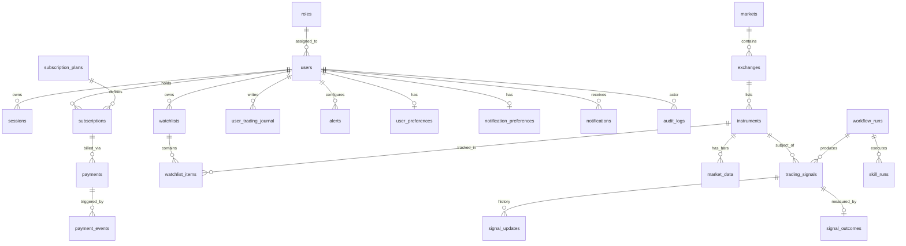

# Normalized PostgreSQL Database Schema Specification

**Database Engine:** PostgreSQL 16+  
**ORM / Migrations:** SQLAlchemy 2.x + Alembic (`database/migrations/`)  
**Timestamp Policy:** All temporal columns use `TIMESTAMPTZ` stored in **UTC**; conversion to `Asia/Kolkata` (IST) or `America/New_York` (ET) happens exclusively at presentation/reporting layers.  
**Monetary Precision Policy:** All prices, fees, amounts, and ratios use `NUMERIC` (`Decimal` in Python) — **never** `REAL` / `DOUBLE PRECISION` / IEEE 754 `float`.  
**Primary Key Policy:** `UUID` (UUIDv7 generated in application or `gen_random_uuid()`) for all core entities to avoid enumerable sequential IDs on public APIs.

---

## 1. Entity Relationship Overview



---

## 2. Complete Table Definitions (27 Normalized Tables)

### 2.1 Identity, RBAC, Single Active Session & Auditing

#### `roles`
| Column | Type | Constraints | Notes |
| --- | --- | --- | --- |
| `id` | `UUID` | `PK` | |
| `code` | `VARCHAR(32)` | `UNIQUE NOT NULL` | `super_admin`, `admin`, `subscriber` |
| `name` | `VARCHAR(64)` | `NOT NULL` | Display name |
| `permissions` | `JSONB` | `NOT NULL DEFAULT '{}'` | Explicit RBAC permission map |
| `created_at` | `TIMESTAMPTZ` | `NOT NULL DEFAULT now()` | |

#### `users`
| Column | Type | Constraints | Notes |
| --- | --- | --- | --- |
| `id` | `UUID` | `PK` | |
| `role_id` | `UUID` | `FK -> roles(id) NOT NULL` | |
| `email` | `CITEXT` | `UNIQUE NOT NULL` | Case-insensitive unique email |
| `password_hash` | `TEXT` | `NOT NULL` | Argon2id hash (never returned in API) |
| `full_name` | `VARCHAR(120)` | `NOT NULL` | |
| `country_code` | `CHAR(2)` | `NOT NULL DEFAULT 'IN'` | ISO-3166-1 alpha-2 (`IN`, `US`, etc.) |
| `is_active` | `BOOLEAN` | `NOT NULL DEFAULT true` | Admin activation/deactivation toggle |
| `is_email_verified` | `BOOLEAN` | `NOT NULL DEFAULT false` | |
| `session_version` | `INTEGER` | `NOT NULL DEFAULT 1` | Incremented on every new login / password reset / forced revoke |
| `last_login_at` | `TIMESTAMPTZ` | `NULL` | |
| `created_at` | `TIMESTAMPTZ` | `NOT NULL DEFAULT now()` | |
| `updated_at` | `TIMESTAMPTZ` | `NOT NULL DEFAULT now()` | |

#### `sessions` (Database-Enforced Single Active Session)
| Column | Type | Constraints | Notes |
| --- | --- | --- | --- |
| `id` | `UUID` | `PK` | |
| `user_id` | `UUID` | `FK -> users(id) ON DELETE CASCADE NOT NULL` | |
| `token_hash` | `CHAR(64)` | `UNIQUE NOT NULL` | SHA-256 hash of opaque 256-bit cookie token |
| `session_version` | `INTEGER` | `NOT NULL` | Must match `users.session_version` |
| `status` | `VARCHAR(24)` | `NOT NULL` | `ACTIVE`, `REVOKED_NEW_LOGIN`, `REVOKED_LOGOUT`, `REVOKED_ADMIN`, `EXPIRED` |
| `ip_address` | `INET` | `NULL` | Client IP |
| `user_agent` | `VARCHAR(512)` | `NULL` | Browser/device summary |
| `created_at` | `TIMESTAMPTZ` | `NOT NULL DEFAULT now()` | |
| `last_seen_at` | `TIMESTAMPTZ` | `NOT NULL DEFAULT now()` | |
| `expires_at` | `TIMESTAMPTZ` | `NOT NULL` | |
| `revoked_at` | `TIMESTAMPTZ` | `NULL` | |
| `revoked_by_user_id` | `UUID` | `FK -> users(id) NULL` | Populated if Super Admin revoked |

**Critical Index (Race-Free Single Active Session Guarantee):**
```sql
CREATE UNIQUE INDEX uq_sessions_one_active_per_user
    ON sessions (user_id)
    WHERE status = 'ACTIVE';
CREATE INDEX ix_sessions_user_created ON sessions (user_id, created_at DESC);
```

#### `password_reset_tokens`
| Column | Type | Constraints | Notes |
| --- | --- | --- | --- |
| `id` | `UUID` | `PK` | |
| `user_id` | `UUID` | `FK -> users(id) ON DELETE CASCADE NOT NULL` | |
| `token_hash` | `CHAR(64)` | `UNIQUE NOT NULL` | One-time token hash |
| `expires_at` | `TIMESTAMPTZ` | `NOT NULL` | Short TTL (e.g., 30 minutes) |
| `used_at` | `TIMESTAMPTZ` | `NULL` | Invalidated immediately on use |
| `created_at` | `TIMESTAMPTZ` | `NOT NULL DEFAULT now()` | |

#### `audit_logs`
| Column | Type | Constraints | Notes |
| --- | --- | --- | --- |
| `id` | `UUID` | `PK` | |
| `actor_user_id` | `UUID` | `FK -> users(id) NULL` | Null for system/webhook actions |
| `action` | `VARCHAR(80)` | `NOT NULL` | e.g., `SESSION_EVICTED`, `KILL_SWITCH_TOGGLED`, `PLAN_UPDATED`, `USER_DEACTIVATED` |
| `resource_type` | `VARCHAR(64)` | `NOT NULL` | e.g., `session`, `user`, `subscription_plan`, `system_settings` |
| `resource_id` | `VARCHAR(64)` | `NULL` | Target entity ID |
| `metadata` | `JSONB` | `NOT NULL DEFAULT '{}'` | Scrubbed context (never secrets/passwords) |
| `ip_address` | `INET` | `NULL` | |
| `created_at` | `TIMESTAMPTZ` | `NOT NULL DEFAULT now()` | Append-only |

**Indexes:** `(actor_user_id, created_at DESC)`, `(action, created_at DESC)`, `(resource_type, resource_id)`.

---

### 2.2 Subscriptions, Plans & Payments

#### `subscription_plans`
| Column | Type | Constraints | Notes |
| --- | --- | --- | --- |
| `id` | `UUID` | `PK` | |
| `code` | `VARCHAR(64)` | `UNIQUE NOT NULL` | e.g., `pro_monthly_in`, `pro_monthly_us`, `all_markets_monthly` |
| `name` | `VARCHAR(120)` | `NOT NULL` | Super Admin editable |
| `description` | `TEXT` | `NOT NULL DEFAULT ''` | |
| `currency` | `CHAR(3)` | `NOT NULL` | `INR` or `USD` |
| `price_amount` | `NUMERIC(14, 2)` | `NOT NULL CHECK (price_amount >= 0)` | Configurable by Super Admin |
| `billing_interval` | `VARCHAR(16)` | `NOT NULL DEFAULT 'monthly'` | `monthly` (extensible to `quarterly`, `annual`) |
| `grace_period_days` | `INTEGER` | `NOT NULL DEFAULT 3` | Configurable grace period on failed renewal |
| `entitled_markets` | `JSONB` | `NOT NULL` | `["IN"]`, `["US"]`, or `["IN", "US"]` |
| `features` | `JSONB` | `NOT NULL DEFAULT '{}'` | Feature flags / AI analyst daily quotas |
| `razorpay_plan_id` | `VARCHAR(128)` | `NULL` | External gateway plan mapping |
| `stripe_price_id` | `VARCHAR(128)` | `NULL` | External gateway price mapping |
| `is_active` | `BOOLEAN` | `NOT NULL DEFAULT true` | |
| `created_at` | `TIMESTAMPTZ` | `NOT NULL DEFAULT now()` | |
| `updated_at` | `TIMESTAMPTZ` | `NOT NULL DEFAULT now()` | |

#### `subscriptions`
| Column | Type | Constraints | Notes |
| --- | --- | --- | --- |
| `id` | `UUID` | `PK` | |
| `user_id` | `UUID` | `FK -> users(id) ON DELETE RESTRICT NOT NULL` | |
| `plan_id` | `UUID` | `FK -> subscription_plans(id) ON DELETE RESTRICT NOT NULL` | |
| `provider` | `VARCHAR(24)` | `NOT NULL` | `razorpay`, `stripe`, `manual_admin` |
| `provider_subscription_id` | `VARCHAR(128)` | `UNIQUE NULL` | |
| `status` | `VARCHAR(24)` | `NOT NULL` | `pending`, `trialing`, `active`, `past_due`, `cancelled`, `expired` |
| `current_period_start` | `TIMESTAMPTZ` | `NULL` | |
| `current_period_end` | `TIMESTAMPTZ` | `NULL` | |
| `grace_until` | `TIMESTAMPTZ` | `NULL` | |
| `cancel_at_period_end` | `BOOLEAN` | `NOT NULL DEFAULT false` | |
| `cancelled_at` | `TIMESTAMPTZ` | `NULL` | |
| `created_at` | `TIMESTAMPTZ` | `NOT NULL DEFAULT now()` | |
| `updated_at` | `TIMESTAMPTZ` | `NOT NULL DEFAULT now()` | |

**Indexes:** `(user_id, status)`, `(status, current_period_end)`.

#### `payments`
| Column | Type | Constraints | Notes |
| --- | --- | --- | --- |
| `id` | `UUID` | `PK` | |
| `user_id` | `UUID` | `FK -> users(id) ON DELETE RESTRICT NOT NULL` | Ownership isolation |
| `subscription_id` | `UUID` | `FK -> subscriptions(id) ON DELETE RESTRICT NOT NULL` | |
| `provider` | `VARCHAR(24)` | `NOT NULL` | `razorpay` or `stripe` |
| `provider_payment_id` | `VARCHAR(128)` | `UNIQUE NOT NULL` | |
| `invoice_number` | `VARCHAR(64)` | `UNIQUE NOT NULL` | Sequential / formatted receipt ID |
| `amount` | `NUMERIC(14, 2)` | `NOT NULL` | |
| `tax_amount` | `NUMERIC(14, 2)` | `NOT NULL DEFAULT 0` | GST / VAT where applicable |
| `currency` | `CHAR(3)` | `NOT NULL` | `INR` or `USD` |
| `status` | `VARCHAR(24)` | `NOT NULL` | `pending`, `succeeded`, `failed`, `refunded` |
| `failure_reason` | `TEXT` | `NULL` | |
| `receipt_url` | `TEXT` | `NULL` | |
| `paid_at` | `TIMESTAMPTZ` | `NULL` | |
| `created_at` | `TIMESTAMPTZ` | `NOT NULL DEFAULT now()` | |

#### `payment_events` (Idempotent Verified Webhook Log)
| Column | Type | Constraints | Notes |
| --- | --- | --- | --- |
| `id` | `UUID` | `PK` | |
| `provider` | `VARCHAR(24)` | `NOT NULL` | `razorpay` or `stripe` |
| `provider_event_id` | `VARCHAR(128)` | `NOT NULL` | Webhook event ID |
| `event_type` | `VARCHAR(80)` | `NOT NULL` | e.g., `subscription.charged`, `invoice.paid` |
| `signature_verified` | `BOOLEAN` | `NOT NULL` | Must be `true` to process |
| `payload` | `JSONB` | `NOT NULL` | Raw verified webhook payload |
| `processing_status` | `VARCHAR(24)` | `NOT NULL` | `received`, `processed`, `ignored`, `failed` |
| `error_message` | `TEXT` | `NULL` | |
| `received_at` | `TIMESTAMPTZ` | `NOT NULL DEFAULT now()` | |
| `processed_at` | `TIMESTAMPTZ` | `NULL` | |

**Unique Constraint:** `UNIQUE (provider, provider_event_id)` (prevents duplicate webhook processing).

---

### 2.3 Markets, Exchanges, Instruments & Market Data

#### `markets`
| Column | Type | Constraints | Notes |
| --- | --- | --- | --- |
| `id` | `UUID` | `PK` | |
| `code` | `VARCHAR(8)` | `UNIQUE NOT NULL` | `IN`, `US` |
| `name` | `VARCHAR(64)` | `NOT NULL` | `Indian Equity Market`, `US Equity Market` |
| `currency` | `CHAR(3)` | `NOT NULL` | `INR`, `USD` |
| `timezone` | `VARCHAR(64)` | `NOT NULL` | `Asia/Kolkata`, `America/New_York` |
| `is_enabled` | `BOOLEAN` | `NOT NULL DEFAULT true` | |

#### `exchanges`
| Column | Type | Constraints | Notes |
| --- | --- | --- | --- |
| `id` | `UUID` | `PK` | |
| `market_id` | `UUID` | `FK -> markets(id) NOT NULL` | |
| `code` | `VARCHAR(16)` | `UNIQUE NOT NULL` | `NSE`, `BSE`, `NASDAQ`, `NYSE` |
| `mic_code` | `VARCHAR(16)` | `NOT NULL` | `XNSE`, `XBOM`, `XNAS`, `XNYS` |
| `name` | `VARCHAR(120)` | `NOT NULL` | |
| `regular_open_local` | `TIME` | `NOT NULL` | `09:15`, `09:30` |
| `regular_close_local` | `TIME` | `NOT NULL` | `15:30`, `16:00` |
| `session_5m_bars` | `INTEGER` | `NOT NULL` | `75` (India), `78` (US) |

#### `market_calendar_overrides`
| Column | Type | Constraints | Notes |
| --- | --- | --- | --- |
| `id` | `UUID` | `PK` | |
| `exchange_id` | `UUID` | `FK -> exchanges(id) NOT NULL` | |
| `session_date` | `DATE` | `NOT NULL` | Local exchange date |
| `override_type` | `VARCHAR(24)` | `NOT NULL` | `HOLIDAY`, `EARLY_CLOSE`, `SPECIAL_SESSION` (e.g., Muhurat Trading) |
| `open_local` | `TIME` | `NULL` | |
| `close_local` | `TIME` | `NULL` | |
| `reason` | `VARCHAR(120)` | `NOT NULL` | |

**Unique Constraint:** `UNIQUE (exchange_id, session_date)`.

#### `instruments`
| Column | Type | Constraints | Notes |
| --- | --- | --- | --- |
| `id` | `UUID` | `PK` | |
| `market_id` | `UUID` | `FK -> markets(id) NOT NULL` | |
| `exchange_id` | `UUID` | `FK -> exchanges(id) NOT NULL` | |
| `symbol` | `VARCHAR(32)` | `NOT NULL` | Canonical exchange symbol (`RELIANCE`, `M&M`, `TSLA`, `BRK.B`) |
| `canonical_code` | `VARCHAR(48)` | `UNIQUE NOT NULL` | `NSE:RELIANCE`, `NASDAQ:TSLA` |
| `company_name` | `VARCHAR(200)` | `NOT NULL` | |
| `asset_type` | `VARCHAR(16)` | `NOT NULL` | `EQUITY`, `ETF`, `INDEX` |
| `sector` | `VARCHAR(80)` | `NULL` | |
| `isin` | `VARCHAR(24)` | `NULL` | International Securities Identification Number |
| `currency` | `CHAR(3)` | `NOT NULL` | `INR`, `USD` |
| `tick_size` | `NUMERIC(10, 4)` | `NOT NULL` | `0.05` (NSE/BSE), `0.01` (US) |
| `lot_size` | `INTEGER` | `NOT NULL DEFAULT 1` | |
| `provider_symbols` | `JSONB` | `NOT NULL DEFAULT '{}'` | `{"licensed_in": "NSE_EQ|INE002A01018", "dev_yahoo": "RELIANCE.NS"}` |
| `is_active` | `BOOLEAN` | `NOT NULL DEFAULT true` | |
| `updated_at` | `TIMESTAMPTZ` | `NOT NULL DEFAULT now()` | |

**Unique Constraint:** `UNIQUE (exchange_id, symbol)`.

#### `market_data` (OHLCV Bars with Mandatory Provenance & Freshness)
| Column | Type | Constraints | Notes |
| --- | --- | --- | --- |
| `id` | `BIGSERIAL` | `PK` | High-volume time-series key |
| `instrument_id` | `UUID` | `FK -> instruments(id) NOT NULL` | |
| `timeframe` | `VARCHAR(8)` | `NOT NULL` | `1m`, `5m`, `15m`, `1d` |
| `bar_start_utc` | `TIMESTAMPTZ` | `NOT NULL` | |
| `bar_end_utc` | `TIMESTAMPTZ` | `NOT NULL` | |
| `open` | `NUMERIC(18, 6)` | `NOT NULL` | |
| `high` | `NUMERIC(18, 6)` | `NOT NULL` | |
| `low` | `NUMERIC(18, 6)` | `NOT NULL` | |
| `close` | `NUMERIC(18, 6)` | `NOT NULL` | |
| `volume` | `BIGINT` | `NOT NULL` | |
| `is_complete` | `BOOLEAN` | `NOT NULL DEFAULT true` | Only `true` bars allowed for signal triggers |
| `source_provider` | `VARCHAR(48)` | `NOT NULL` | Mandatory provenance |
| `fetched_at_utc` | `TIMESTAMPTZ` | `NOT NULL` | Mandatory freshness timestamp |

**Unique Constraint & Index:** `UNIQUE (instrument_id, timeframe, bar_start_utc)`; `INDEX (instrument_id, timeframe, bar_start_utc DESC)`.

#### `provider_status`
| Column | Type | Constraints | Notes |
| --- | --- | --- | --- |
| `id` | `UUID` | `PK` | |
| `provider_code` | `VARCHAR(48)` | `UNIQUE NOT NULL` | e.g., `licensed_india`, `licensed_us`, `sec_edgar`, `house_ptr` |
| `market_code` | `VARCHAR(8)` | `NOT NULL` | `IN`, `US`, `ALL` |
| `status` | `VARCHAR(24)` | `NOT NULL` | `HEALTHY`, `DEGRADED`, `DOWN` |
| `last_success_at` | `TIMESTAMPTZ` | `NULL` | |
| `last_error_at` | `TIMESTAMPTZ` | `NULL` | |
| `last_error_message` | `TEXT` | `NULL` | |
| `avg_latency_ms` | `INTEGER` | `NULL` | |
| `daily_api_calls` | `INTEGER` | `NOT NULL DEFAULT 0` | API usage & cost tracking |
| `updated_at` | `TIMESTAMPTZ` | `NOT NULL DEFAULT now()` | |

---

### 2.4 Workflows, Skills & Intelligence Signals

#### `system_settings` (Including Global Emergency Kill Switch)
| Column | Type | Constraints | Notes |
| --- | --- | --- | --- |
| `key` | `VARCHAR(80)` | `PK` | e.g., `kill_switch_enabled`, `signal_expiry_minutes_in` |
| `value` | `JSONB` | `NOT NULL` | |
| `updated_by_user_id` | `UUID` | `FK -> users(id) NULL` | |
| `updated_at` | `TIMESTAMPTZ` | `NOT NULL DEFAULT now()` | |

#### `workflow_runs`
| Column | Type | Constraints | Notes |
| --- | --- | --- | --- |
| `id` | `UUID` | `PK` | Unique `workflow_run_id` |
| `market_id` | `UUID` | `FK -> markets(id) NOT NULL` | |
| `workflow_type` | `VARCHAR(48)` | `NOT NULL` | `PREMARKET_SCAN`, `INTRADAY_ORB`, `OUTCOME_TRACKER`, `FUNDAMENTALS`, `PELOSI_PTR` |
| `idempotency_key` | `CHAR(64)` | `NOT NULL` | SHA-256 of `(workflow_type, market_code, session_date, slot_utc)` |
| `status` | `VARCHAR(24)` | `NOT NULL` | `QUEUED`, `RUNNING`, `SUCCEEDED`, `PARTIAL`, `FAILED`, `ABORTED_KILL_SWITCH` |
| `triggered_by` | `VARCHAR(32)` | `NOT NULL` | `scheduler`, `manual_admin`, `retry` |
| `started_at` | `TIMESTAMPTZ` | `NULL` | |
| `finished_at` | `TIMESTAMPTZ` | `NULL` | |
| `summary` | `JSONB` | `NOT NULL DEFAULT '{}'` | Scanned count, hits, published signals, rejected signals |
| `error_message` | `TEXT` | `NULL` | |
| `created_at` | `TIMESTAMPTZ` | `NOT NULL DEFAULT now()` | |

**Unique Constraint:** `UNIQUE (workflow_type, market_id, idempotency_key)`.

#### `skill_runs`
| Column | Type | Constraints | Notes |
| --- | --- | --- | --- |
| `id` | `UUID` | `PK` | |
| `workflow_run_id` | `UUID` | `FK -> workflow_runs(id) ON DELETE CASCADE NOT NULL` | |
| `skill_name` | `VARCHAR(48)` | `NOT NULL` | One of the 11 skills or `ai_analyst` |
| `status` | `VARCHAR(24)` | `NOT NULL` | `RUNNING`, `SUCCEEDED`, `FAILED`, `SKIPPED` |
| `retry_count` | `INTEGER` | `NOT NULL DEFAULT 0` | |
| `duration_ms` | `INTEGER` | `NULL` | |
| `input_summary` | `JSONB` | `NOT NULL DEFAULT '{}'` | |
| `output_summary` | `JSONB` | `NOT NULL DEFAULT '{}'` | |
| `error_trace` | `TEXT` | `NULL` | |
| `started_at` | `TIMESTAMPTZ` | `NOT NULL DEFAULT now()` | |
| `finished_at` | `TIMESTAMPTZ` | `NULL` | |

#### `trading_signals` (Immutable Published Signal Snapshots)
| Column | Type | Constraints | Notes |
| --- | --- | --- | --- |
| `id` | `UUID` | `PK` | Signal ID |
| `workflow_run_id` | `UUID` | `FK -> workflow_runs(id) NOT NULL` | |
| `idempotency_key` | `CHAR(64)` | `UNIQUE NOT NULL` | Prevents duplicate signals on retries |
| `market_id` | `UUID` | `FK -> markets(id) NOT NULL` | |
| `exchange_id` | `UUID` | `FK -> exchanges(id) NOT NULL` | |
| `instrument_id` | `UUID` | `FK -> instruments(id) NOT NULL` | |
| `strategy` | `VARCHAR(64)` | `NOT NULL` | `orb_15m`, `breakout_20d`, `bull_flag`, `reclaim_ma20`, `oversold_bounce`, etc. |
| `signal_type` | `VARCHAR(16)` | `NOT NULL` | `BUY`, `SELL`, `WATCH` |
| `entry_price` | `NUMERIC(18, 6)` | `NOT NULL` | Immutable snapshot |
| `stop_loss` | `NUMERIC(18, 6)` | `NOT NULL` | Immutable snapshot |
| `target_price` | `NUMERIC(18, 6)` | `NOT NULL` | Immutable snapshot |
| `risk_reward_ratio` | `NUMERIC(8, 3)` | `NOT NULL` | Deterministic `(target - entry) / (entry - stop)` |
| `confidence_score` | `NUMERIC(5, 2)` | `NOT NULL CHECK (confidence_score >= 0 AND confidence_score <= 100)` | Composite Setup Quality Score (NOT probability of profit) |
| `confidence_breakdown` | `JSONB` | `NOT NULL` | Component weights & scores |
| `ai_reasoning` | `TEXT` | `NULL` | LLM explanation (read-only context) |
| `technical_indicators` | `JSONB` | `NOT NULL DEFAULT '{}'` | RSI-14, ATR-14, OR high/low, MA20, volume ratio |
| `news_context` | `JSONB` | `NOT NULL DEFAULT '{}'` | Relevant headlines/filings at generation time |
| `timemachine_summary` | `JSONB` | `NULL` | Seed, MC odds, historical replay summary |
| `broker_ticket_preview` | `JSONB` | `NULL` | Read-only broker ticket preview (never executed) |
| `risk_validation_status` | `VARCHAR(16)` | `NOT NULL` | `PASSED`, `REJECTED` |
| `risk_validation_details` | `JSONB` | `NOT NULL` | Exact rule verdicts & fingerprint |
| `data_source_provider` | `VARCHAR(48)` | `NOT NULL` | |
| `data_as_of_utc` | `TIMESTAMPTZ` | `NOT NULL` | |
| `current_status` | `VARCHAR(24)` | `NOT NULL` | `Pending`, `Active`, `Triggered`, `Target Hit`, `Stop Loss Hit`, `Expired`, `Cancelled`, `Rejected` |
| `generated_at_utc` | `TIMESTAMPTZ` | `NOT NULL DEFAULT now()` | |
| `expires_at_utc` | `TIMESTAMPTZ` | `NOT NULL` | |
| `last_updated_at_utc` | `TIMESTAMPTZ` | `NOT NULL DEFAULT now()` | |

**Immutability Rule:** Application repository layer and a PostgreSQL `BEFORE UPDATE` trigger forbid modifying `entry_price`, `stop_loss`, `target_price`, `risk_reward_ratio`, `signal_type`, `generated_at_utc`, or `risk_validation_status` after insert. Only `current_status` and `last_updated_at_utc` may transition forward, and every transition must insert a `signal_updates` row.

#### `signal_updates`
| Column | Type | Constraints | Notes |
| --- | --- | --- | --- |
| `id` | `UUID` | `PK` | |
| `signal_id` | `UUID` | `FK -> trading_signals(id) ON DELETE RESTRICT NOT NULL` | |
| `previous_status` | `VARCHAR(24)` | `NOT NULL` | |
| `new_status` | `VARCHAR(24)` | `NOT NULL` | |
| `trigger_price` | `NUMERIC(18, 6)` | `NULL` | Observed bar price causing transition |
| `bar_timestamp_utc` | `TIMESTAMPTZ` | `NULL` | |
| `reason` | `TEXT` | `NOT NULL` | |
| `created_at_utc` | `TIMESTAMPTZ` | `NOT NULL DEFAULT now()` | Append-only |

#### `signal_outcomes`
| Column | Type | Constraints | Notes |
| --- | --- | --- | --- |
| `id` | `UUID` | `PK` | |
| `signal_id` | `UUID` | `FK -> trading_signals(id) UNIQUE NOT NULL` | One immutable outcome record per closed signal |
| `final_status` | `VARCHAR(24)` | `NOT NULL` | `Target Hit`, `Stop Loss Hit`, `Expired`, `Cancelled` |
| `triggered_at_utc` | `TIMESTAMPTZ` | `NULL` | |
| `closed_at_utc` | `TIMESTAMPTZ` | `NOT NULL` | |
| `assumed_entry_price` | `NUMERIC(18, 6)` | `NOT NULL` | Includes documented slippage model |
| `assumed_exit_price` | `NUMERIC(18, 6)` | `NOT NULL` | Includes conservative stop-first tie-break |
| `estimated_cost_bps` | `NUMERIC(8, 2)` | `NOT NULL` | Market-specific brokerage/statutory/slippage bps |
| `gross_return_pct` | `NUMERIC(10, 4)` | `NOT NULL` | |
| `net_return_pct` | `NUMERIC(10, 4)` | `NOT NULL` | |
| `realized_r_multiple` | `NUMERIC(8, 3)` | `NOT NULL` | |
| `methodology_version` | `VARCHAR(32)` | `NOT NULL` | e.g., `v1.0-conservative-stop-first` |
| `calculated_at_utc` | `TIMESTAMPTZ` | `NOT NULL DEFAULT now()` | |

#### `market_news`, `company_fundamentals`, `congress_disclosures`
- **`market_news`**: `id`, `market_id`, `instrument_id (NULL for macro)`, `source`, `headline`, `summary`, `url`, `tags (JSONB)`, `is_regulatory_filing`, `filing_type`, `dedupe_hash (UNIQUE)`, `published_at_utc`, `fetched_at_utc`.
- **`company_fundamentals`**: `id`, `instrument_id`, `period_end_date`, `fiscal_period`, `filing_source` (`SEC_EDGAR` | `NSE_XBRL` | `VENDOR`), `revenue`, `gross_margin_pct`, `operating_margin_pct`, `net_margin_pct`, `net_income`, `diluted_eps`, `is_derived_q4`, `raw_metrics (JSONB)`, `filing_url`, `filed_at_utc`. `UNIQUE (instrument_id, period_end_date, fiscal_period)`.
- **`congress_disclosures`** *(US Market Only)*: `id`, `doc_id`, `member_name`, `district`, `owner_type` (`SP`|`JT`|`DC`|`SELF`), `instrument_id (NULL)`, `raw_ticker`, `asset_description`, `transaction_type`, `amount_range`, `trade_date`, `filing_date`, `disclosure_delay_days`, `is_late_filing`, `source_pdf_url`, `created_at_utc`. `UNIQUE (doc_id, raw_ticker, trade_date, transaction_type, amount_range)`.

---

### 2.5 Strictly User-Isolated Workspace Tables

Every table below enforces `user_id UUID NOT NULL REFERENCES users(id) ON DELETE CASCADE` and every repository query filters by `user_id = :current_user_id`.

- **`watchlists`**: `id`, `user_id`, `name`, `market_scope` (`IN`|`US`|`ALL`), `is_default`, `created_at`, `updated_at`.
- **`watchlist_items`**: `id`, `watchlist_id (FK)`, `user_id (FK)`, `instrument_id (FK)`, `notes`, `created_at`. `UNIQUE (watchlist_id, instrument_id)`.
- **`user_preferences`**: `user_id (PK, FK)`, `default_market` (`ALL`|`IN`|`US`), `theme` (`dark`|`light`), `display_timezone`, `default_budget_inr (NUMERIC)`, `default_max_loss_inr (NUMERIC)`, `default_budget_usd (NUMERIC)`, `default_max_loss_usd (NUMERIC)`, `updated_at`.
- **`user_trading_journal`**: `id`, `user_id`, `signal_id (FK NULL)`, `instrument_id (FK)`, `market_id (FK)`, `side` (`BUY`|`SELL`), `entry_price`, `exit_price`, `quantity`, `planned_stop`, `planned_target`, `realized_pnl`, `currency`, `emotions_tags (JSONB)`, `notes`, `entered_at_utc`, `exited_at_utc`, `created_at`, `updated_at`.
- **`alerts`**: `id`, `user_id`, `instrument_id (FK NULL)`, `signal_id (FK NULL)`, `rule_type` (`above`|`below`|`stop`|`target`|`pct_move`|`time`|`opening_bell`), `threshold_value (NUMERIC)`, `rearm (BOOL)`, `active_date (DATE NULL)`, `is_active`, `last_triggered_at_utc`, `created_at`.
- **`notification_preferences`**: `user_id (PK, FK)`, `in_app_enabled`, `browser_push_enabled`, `email_enabled`, `notify_new_signals`, `notify_entry_hit`, `notify_target_hit`, `notify_stop_hit`, `notify_signal_expiry`, `notify_market_news`, `notify_market_reports`, `market_filter` (`ALL`|`IN`|`US`), `quiet_hours_json (JSONB)`, `updated_at`.
- **`notifications`**: `id`, `user_id`, `category`, `title`, `body`, `payload (JSONB)`, `dedupe_key`, `channel_status (JSONB)`, `is_read (BOOL)`, `read_at_utc`, `created_at_utc`. `UNIQUE (user_id, dedupe_key)` to prevent duplicate notifications.

---

## 3. Data Retention & Archival Policy

| Table Group | Online Retention | Archival / Pruning Policy |
| --- | --- | --- |
| `trading_signals`, `signal_updates`, `signal_outcomes` | **Permanent (Never Deleted)** | Immutable historical record for compliance & verifiable performance |
| `payments`, `payment_events`, `subscriptions`, `audit_logs` | **7 Years Minimum** | Tax, accounting, and security audit compliance |
| `market_data` (`1m` bars) | 90 days hot | Partitioned monthly; roll off to cold Parquet archive after 90 days |
| `market_data` (`5m` bars) | 2 years hot | Partitioned quarterly; required for Time Machine & outcome replay |
| `market_data` (`1d` bars) | 10+ years hot | Compact storage; permanent for multi-year technicals |
| `workflow_runs`, `skill_runs` | 180 days hot | Summarize & archive older verbose `error_trace` payloads |
| `sessions` (revoked/expired) | 90 days | Prune expired non-active rows after 90 days (audit events retained in `audit_logs`) |
| `notifications` (read) | 180 days | Prune read notifications older than 180 days |
